# evercland

**a place in the dreams, in the terminal.**

Evercland draws a small landscape into your terminal: a pond in the middle
distance, trees around it, mountains behind, and a sky that changes with the hour
and the season. It's plain Python with no dependencies, and the whole picture is
made of half blocks and 24-bit colour — those mountains are literally characters
in your shell.

Here is the same corner of the world at noon, once in winter and once in summer:

<table>
  <tr>
    <td align="center">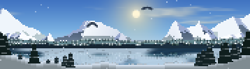</td>
    <td align="center">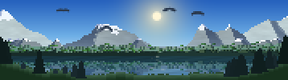</td>
  </tr>
  <tr>
    <td align="center"><sub>winter</sub></td>
    <td align="center"><sub>summer</sub></td>
  </tr>
</table>

<sub>179 × 25 cells, seed 1651, noon. Same landscape, same hour, different season.</sub>

---

## install

You can run it right out of the checkout:

```
./evercland
```

Or put it on your PATH, either with make or as a pacman package:

```
sudo make install            # to /usr/local, set PREFIX= to change that
makepkg -si                  # or as a pacman package, from this directory
```

All it asks for is Python 3 and a terminal that speaks truecolor — kitty,
alacritty, foot, wezterm, most of the modern ones. On something older it will
still run, but it comes out as a grey smear, so if the sky looks flat and the
sun is a blob, that's usually why.

## use

```
evercland                       one random landscape
evercland -d dusk -e autumn     an autumn evening
evercland -l -d auto -e auto    live view that follows your clock and calendar
evercland -S                    screensaver
```

```
  -l, --live            live mode: clouds drift, water moves, snow falls
  -i, --infinite        infinite mode: keep making new landscapes (implies -l)
  -w, --wait=SEC        seconds between landscapes in infinite mode [20]
  -t, --time=SEC        seconds between frames in live mode [0.1]
  -S, --screensaver     screensaver mode: -l -i, and any key quits
  -d, --daytime=TIME    dawn, day, dusk, night, auto or random [random]
  -e, --season=SEASON   spring, summer, autumn, winter, auto or random [random]
  -s, --seed=N          seed for the random number generator
  -a, --aspect=RATIO    pixel height/width, if the sun looks squashed or stretched
  -m, --message=TEXT    show a message under the landscape
  -p, --print           print the last frame when you quit live mode
  -v, --verbose         show the seed, season and time of day
  -V, --version         print the version and exit
  -h, --help            show this help
```

In live mode the picture redraws itself to follow the window if you resize it, and
`q` gets you out.

Everything is deterministic. Same seed, same size, same `-d` and `-e`, same
picture — so when one comes up that you like, `-v` prints the seed and you can ask
for it again tomorrow.

## the seasons

All sixteen frames below are **seed 7**, which means the mountains and the pond
sit in the same place in every single one. Only the hour and the season change,
and it's a pretty good way to see how much of the mood lives in the palette.

<table>
  <tr>
    <th></th>
    <th>dawn</th>
    <th>day</th>
    <th>dusk</th>
    <th>night</th>
  </tr>
  <tr>
    <th align="right">spring</th>
    <td>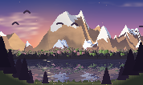</td>
    <td>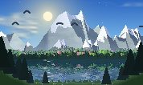</td>
    <td>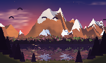</td>
    <td>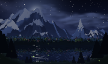</td>
  </tr>
  <tr>
    <th align="right">summer</th>
    <td>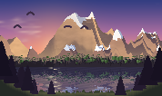</td>
    <td>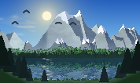</td>
    <td>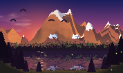</td>
    <td>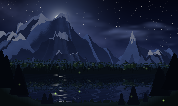</td>
  </tr>
  <tr>
    <th align="right">autumn</th>
    <td>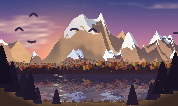</td>
    <td>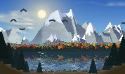</td>
    <td>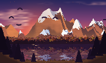</td>
    <td>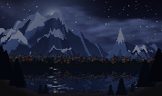</td>
  </tr>
  <tr>
    <th align="right">winter</th>
    <td>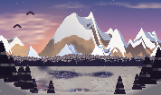</td>
    <td>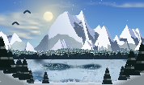</td>
    <td>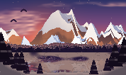</td>
    <td>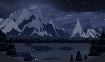</td>
  </tr>
</table>

- **spring** — pink blossoms, flowers along the shore, petals drifting off
- **summer** — deep green, hardly any snow left, fireflies once it gets dark
- **autumn** — orange and red, leaves coming down, big flocks of birds
- **winter** — snow on the peaks and the pines, bare branches, a half frozen pond

`auto` works the season out from the calendar. Northern hemisphere only, sorry.

## it fits any window

The landscape is built for whatever space it gets, rather than drawn once and
cropped. A small window means fewer, chunkier pixels and a simpler scene; a big
one fills in the same view with more detail.

Here's one autumn evening at three sizes:

<table>
  <tr>
    <td align="center"><br><sub>178 × 53</sub></td>
    <td align="center"><br><sub>86 × 25</sub></td>
    <td align="center">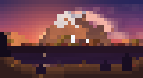<br><sub>40 × 11</sub></td>
  </tr>
</table>

<details>
<summary>the other two sizes, all sixteen frames</summary>
<br>

**86 × 25**

<table>
  <tr>
    <th></th>
    <th>dawn</th>
    <th>day</th>
    <th>dusk</th>
    <th>night</th>
  </tr>
  <tr>
    <th align="right">spring</th>
    <td>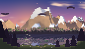</td>
    <td>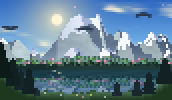</td>
    <td>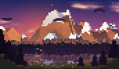</td>
    <td>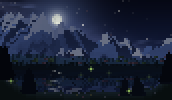</td>
  </tr>
  <tr>
    <th align="right">summer</th>
    <td>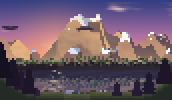</td>
    <td>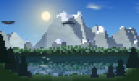</td>
    <td>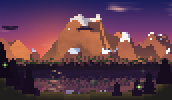</td>
    <td>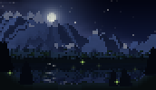</td>
  </tr>
  <tr>
    <th align="right">autumn</th>
    <td>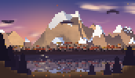</td>
    <td>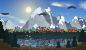</td>
    <td></td>
    <td>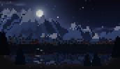</td>
  </tr>
  <tr>
    <th align="right">winter</th>
    <td>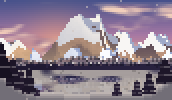</td>
    <td>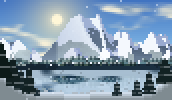</td>
    <td>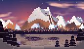</td>
    <td>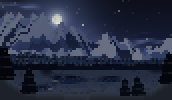</td>
  </tr>
</table>

**40 × 11**

<table>
  <tr>
    <th></th>
    <th>dawn</th>
    <th>day</th>
    <th>dusk</th>
    <th>night</th>
  </tr>
  <tr>
    <th align="right">spring</th>
    <td>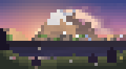</td>
    <td>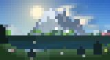</td>
    <td>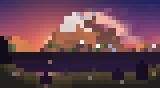</td>
    <td>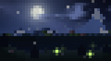</td>
  </tr>
  <tr>
    <th align="right">summer</th>
    <td>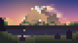</td>
    <td>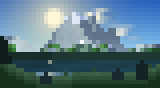</td>
    <td>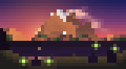</td>
    <td>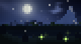</td>
  </tr>
  <tr>
    <th align="right">autumn</th>
    <td>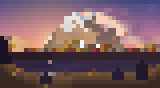</td>
    <td>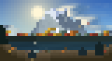</td>
    <td></td>
    <td>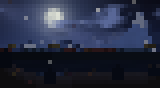</td>
  </tr>
  <tr>
    <th align="right">winter</th>
    <td>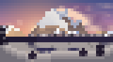</td>
    <td></td>
    <td>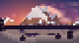</td>
    <td>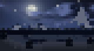</td>
  </tr>
</table>

</details>

## how it draws

Every character it prints is an upper half block (`▀`). The foreground colour
fills the top pixel, the background colour fills the bottom one, so a single cell
carries two rows of the picture. That's the whole trick — no image buffer, no
graphics protocol, just coloured text at the size your terminal already has.

```
evercland              launcher
src/evercland/
  cli.py            arguments, live loop, infinite mode
  scene.py          builds the landscape and draws frames
  trees.py          pine, broadleaf and bare tree sprites
  palette.py        colours, and what each season changes
  terminal.py       ansi output, window size, raw keys
  colors.py         colour maths
  noise.py          value noise
```

The landscape comes out of value noise, with a seeded `random.Random` deciding
where the trees and the shoreline land, and a palette deciding what colour the
light is at that hour. Nothing is loaded from disk, and no two seeds give you the
same pond.

## notes

- A terminal cell is usually a bit taller than 2:1, which would leave the sun
  looking squashed. Evercland asks the terminal for its real pixel size and
  corrects for it, but some multiplexers won't answer — if the sun looks off,
  `-a 1.2` or thereabouts sorts it out by hand.
- Big windows take a moment. A 300 × 170 canvas needs about half a second of
  noise before the first frame shows up.
- The pictures in this README are the program's own output, cell for cell, scaled
  up with nearest neighbour and nothing else.

## license

GPL-3.0-or-later. The full text is in [COPYING](COPYING).
